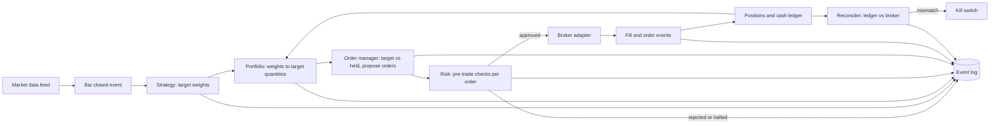

# kestrel

A systematic trading bot that trades crypto spot and US ETFs from one
codebase, built from an empty repo as a learning project — and,
eventually, a portfolio piece. Every module is meant to map to a
trading concept, with the code and docs explaining why it's there.

**This is a work in progress, built incrementally and in the open.**
The full pitch — live dashboard, results table, "what I learned" — is
a Phase 6 deliverable and doesn't exist yet. What's below is an honest
account of what's actually built right now.

## Status: Phases 0–2 done (scaffold, research toolkit, event-driven engine)

See [docs/progress.md](docs/progress.md) for the full, unvarnished
rundown — including the real crypto backfill and backtest runs, the
data-quality issues and bugs they surfaced, and what's still blocked.
Short version:

- **Phase 0** — scaffold (`uv`, `ruff`, `mypy --strict` on `core/`,
  pre-commit, CI), `Settings`, per-sleeve config, core domain types,
  venue data fetchers (Binance, Kraken, Alpaca), Parquet storage,
  validation, local Postgres + Alembic. **Blocked:** the equities
  backfill needs a free Alpaca paper-account API key, not yet supplied.
- **Phase 1** — `research/stats.py` (every metric, hand-tested),
  the vectorized backtester, all five strategies from the spec (each
  with a vectorized form and an event-driven `on_bar` form), and
  `notebooks/01_first_look.ipynb` run end to end on real BTC data.
- **Phase 2** — the full event-driven engine: cost/fill models, a
  `SimBroker`, a diff-based idempotent order manager, pre-trade risk
  checks, kill switches (daily loss, drawdown), and the Postgres event
  log. `kestrel backtest trend_vol_target --sleeve crypto` runs on the
  real BTC/ETH history end to end. No-look-ahead, order-manager
  convergence and risk-limit property tests, a parity test against the
  vectorized backtester, and a golden-hash regression test all pass —
  see `docs/progress.md` for two real bugs those caught before they
  became silent wrong answers.

Everything from here (the validation pipeline with DSR/PBO, paper
trading, observability, the public dashboard, and — only if explicitly
unlocked later — real money) is unbuilt. The full phase plan is
[docs/SPEC.md](docs/SPEC.md) Section 12.

## Why build this

- **Trade both markets from day one**: crypto spot and US ETFs, each
  its own sleeve with its own capital and risk limits, behind one
  broker-adapter interface.
- **Backtest honestly**: event-driven engine, realistic costs,
  walk-forward validation, a locked hold-out, and overfitting
  statistics (Deflated Sharpe Ratio, Probability of Backtest
  Overfitting) — once Phases 2–3 are built.
- **Run unattended in paper mode**, recovering from crashes and
  disconnects without intervention.
- **Be live-capable later**, behind explicit, code-enforced gates — see
  [docs/SPEC.md](docs/SPEC.md) Section 13. No real money moves before
  that's deliberately unlocked.

## Target architecture

One codebase, four run modes (`backtest`, `sim`, `sandbox`, `live`)
selected by config; only the clock, data feed and broker adapter
change between them — strategy, portfolio, risk and order-manager code
is identical across all four. This is the shape being built *toward*;
most of it doesn't exist yet (see Status above).



## Quick start

```sh
git clone git@github.com:magai2002/kestrel.git && cd kestrel
make setup                           # uv sync + pre-commit install
make test                            # unit + property + parity + golden tests
make typecheck                       # mypy --strict on core/, execution/, risk/

make up && make migrate              # local Postgres + Alembic baseline
make data-crypto                     # real Binance/Kraken backfill, no keys needed
make data-equities                   # needs KESTREL_ALPACA_* in .env, see .env.example
make data-validate                   # print the validation report

make sync-instruments                # real tick/step/min-notional from Binance
make backtest                        # kestrel backtest trend_vol_target --sleeve crypto
```

A one-command `make demo` that runs a backtest on a committed data
sample from a fresh clone is a Phase 6 deliverable, once there's a
dashboard/results story to show alongside it.

## Repo layout

See [docs/SPEC.md](docs/SPEC.md) Section 4.2 for the full intended
layout. What exists today: `core/` (domain types: `Instrument`, `Bar`,
`Order`, `Fill`, `Position`, events, `Clock`), `config/` (`Settings`,
per-sleeve YAML), `data/` (venue fetchers, Parquet store, validation),
`research/` (metrics, vectorized backtester), `strategies/` (all five
from the spec), `portfolio/` (sizing, construction), `risk/`
(pre-trade checks, kill switches), `execution/` (costs, fills,
`SimBroker`, order manager), `backtest/` (the event-driven engine),
`cli.py`, `migrations/` (Alembic), `tests/`. `live/`, `api/`,
`observability/` and `web/` arrive with the phases that need them.

## Docs

- [docs/SPEC.md](docs/SPEC.md) — the full build spec this project follows.
- [docs/progress.md](docs/progress.md) — phase-by-phase status, warts included.
- [docs/api-notes.md](docs/api-notes.md) — venue-API surprises, verified against real responses.
- [docs/adr/](docs/adr/) — architecture decisions and their trade-offs.
- [CLAUDE.md](CLAUDE.md) — commands and conventions for working in this repo.

## Disclaimer

Educational project. Paper trading only unless and until Phase 7 is
explicitly unlocked, behind gates described in
[docs/SPEC.md](docs/SPEC.md) Section 13. Nothing here is financial
advice.
