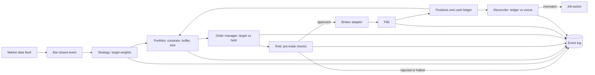

# kestrel

[](https://github.com/magai2002/kestrel/actions/workflows/ci.yml)


A systematic trading bot that paper-trades crypto and ETFs from one
codebase, built from an empty repo as a learning project. It's
deliberately **honest about its own results**: every strategy is judged
walk-forward with full costs, the trial count it took to find it, and a
locked hold-out, and the report says plainly when a strategy doesn't
survive. Most don't.

**Live dashboard:** <https://bot.alexeymagay.com>. Paper trading. Not
financial advice.

## What it does

- **Two markets, one engine.** A crypto sleeve (BTC, ETH; 4-hour bars;
  Binance history, Kraken live prices) and an ETF sleeve (ten asset
  classes; daily bars). The ETFs are researched on US funds and traded
  as their EU UCITS twins through Interactive Brokers
  ([ADR 0004](docs/adr/0004-ibkr-ucits-hybrid-data.md)).
- **Honest validation.**
  - walk-forward parameter selection
  - Deflated Sharpe Ratio from a trial ledger of everything ever tried
  - Probability of Backtest Overfitting
  - block-bootstrap confidence intervals
  - 0–3× cost sensitivity, per-regime tables
  - a hold-out that can be looked at exactly once

  See the [methodology](docs/validation-methodology.md).
- **Paper trading that survives the real world.**
  - deterministic, idempotent orders
  - "journal before send, look up before retry"
  - reconciliation against the venue every bar
  - six kill switches that stay tripped until a human resets them
- **Observability**: Prometheus metrics, a Grafana dashboard and alert
  rules, ntfy push alerts, JSON logs, a runbook.
- **Safety gates for real money**: live mode is locked in code behind a
  checklist (Phase 7), and the public API never exposes balances.

## Architecture



| Mode | Clock | Prices | Broker | Purpose |
| --- | --- | --- | --- | --- |
| `backtest` | simulated | stored history | `SimBroker` (cost + fill model) | research, validation |
| `sim` | wall clock | Kraken (crypto), Yahoo/IBKR (ETF twins) | `SimBroker` | paper trading on real prices |
| `sandbox` | wall clock | venue | Binance Spot Testnet, IBKR paper | exercise real order APIs |
| `live` | wall clock | venue | Kraken, IBKR | **locked** behind Phase 7 gates |

Strategy, portfolio, risk and order-manager code is identical in every
mode: one function makes every rebalancing decision. A test drives the
live `sim` loop bar by bar and requires it to reproduce the backtest
engine's equity curve to 1e-9.

## Results (walk-forward, out-of-sample, all costs)

| Strategy | Sleeve | OOS Sharpe | Baseline | DSR | PBO | OOS max DD | Verdict |
| --- | --- | --- | --- | --- | --- | --- | --- |
| Trend + vol targeting | ETFs | 0.85 | 0.75 (buy & hold) | 0.87 | 0.44 | −12% | fails DSR > 0.95 |
| Trend + vol targeting | crypto | 0.44 | 0.35 (buy & hold) | 0.70 | 0.92 | −24% | fails DSR, PBO |
| Cross-sectional momentum | ETFs | 0.28 | 0.46 (equal weight) | 0.57 | 0.60 | −15% | fails |
| Cross-sectional momentum | crypto | 0.28 | 0.62 (equal weight) | 0.62 | 0.72 | −38% | fails |
| Short-term mean reversion | ETFs | −0.19 | 0.75 (buy & hold SPY) | 0.22 | 0.70 | −3% | fails (costs) |
| Short-term mean reversion | crypto | −3.25 | 0.73 (buy & hold BTC) | 0.00 | 0.00 | −91% | fails (costs) |

**Caveats, read them:**
- Out-of-sample means walk-forward: parameters picked on earlier data,
  judged on the next six months, repeatedly. The most recent 25% of
  history is a **locked hold-out that hasn't been evaluated yet**, so
  these aren't final numbers.
- Four to six years of OOS data can't distinguish a modest edge from
  luck after nine tries; that's what a DSR below 0.95 says.
- The ETF sleeve's costs are the UCITS twins' (IBKR minimum
  commissions, Belgian transaction tax), and some of them are still
  unverified assumptions, listed in every report.
- Trend following's real contribution here is drawdown: −12% vs −23%
  on ETFs and −24% vs −72% on crypto, against buy-and-hold over the
  same windows.

Full table, including the baselines: [docs/progress.md](docs/progress.md).

## Engineering highlights

- **Backtest/live parity by construction**: one `plan_rebalance` for
  every mode, plus a replay test.
- **Idempotent orders**: deterministic client ids (UUIDv5 on the wire),
  an `intent` row journalled before every send, and a venue lookup
  before every retry. Chaos tests cover the engine dying between send
  and ack, a 5xx after acceptance, network drops and restarts mid-bar;
  each ends reconciled with no duplicate order.
- **One adapter contract suite** run against four `LiveBroker`
  implementations (ccxt Binance/Kraken, `ib_async` IBKR, an in-memory
  fault-injecting venue).
- **Property tests (hypothesis)**: no look-ahead (it caught a real leak),
  order-manager convergence under random partial fills, and risk limits
  never exceeded.
- **Bugs found by running it for real**, written up in
  [docs/progress.md](docs/progress.md). Two examples: a buffer/limit
  interaction that rejected 224 of 311 orders, and a validation job
  OOM-killed inside its 512 MB container.

## Quick start

```sh
git clone https://github.com/magai2002/kestrel.git && cd kestrel
make setup     # uv sync + pre-commit hooks
make demo      # committed ETF sample, no keys, no database: a backtest + a full validation report, < 1 min
make test      # ~390 tests: unit, property, parity, replay, contract, chaos
```

Running it for real (Postgres, data backfill, paper trading, Docker
deployment): [CLAUDE.md](CLAUDE.md) has every command, and
[docs/runbook.md](docs/runbook.md) covers operations.

## Docs

- [Validation methodology](docs/validation-methodology.md): for a non-quant reader
- [Architecture decision records](docs/adr/)
- [Runbook](docs/runbook.md)
- [API notes](docs/api-notes.md): every venue quirk, verified against real responses
- [Progress](docs/progress.md): phase by phase, warts included
- [Build spec](docs/SPEC.md)

## What I learned

*(Alexey writes this part.)*

## Disclaimer

Educational project. Paper trading only unless and until the Phase 7
gates are explicitly unlocked. Nothing here is financial advice. Tax
notes (Belgian TOB, capital gains) describe the author's situation, not
general advice.
