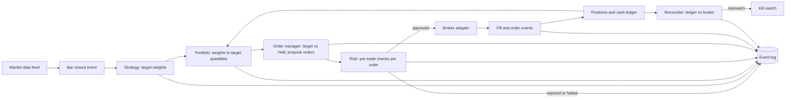

# Build spec: `kestrel`, a multi-market systematic trading bot

> **For Alexey: how to use this file.** Create an empty repo, save this file as `docs/SPEC.md`, open Claude Code in the repo and say: *"Read docs/SPEC.md end to end, then start Phase 0. Stop at the end of each phase for my review."* Rename `kestrel` to anything you like before Phase 0 by doing a find-and-replace on this file. Sections marked **[DECISION]** are choices the agent must confirm with you before building.

---

## 0. Your role and how to work with me

You are building a production-quality, portfolio-grade systematic trading system from an empty repository. I'm a software engineer, strong in Python and comfortable with React, Docker and Linux ops. I'm **learning trading as I go**, so the system is also a teaching tool.

**Working rules**

1. **Work phase by phase** (Section 12). At the end of each phase: all tests green, a one-command demo works, `docs/progress.md` is updated, and you stop and give me a walkthrough. The walkthrough covers what you built, *why* each design choice was made, which trading concept it implements, and what I should try by hand. Don't start the next phase until I say so.
2. **Explain new territory, diff small changes.** When something is new (a trading concept, an unfamiliar library), explain the concept and the rationale, and use analogies where they help. For small fixes, show targeted diffs, not whole-file rewrites.
3. **Never guess at external APIs.** Read the current official docs for ccxt, alpaca-py and the Binance Spot Testnet before writing adapter code. If docs and reality disagree, write a failing test that captures reality, then fix the code. Note anything surprising in `docs/api-notes.md`.
4. **No real money, ever, unless Phase 7 has been explicitly unlocked by me.** Never ask for, store or use live API keys before then. Live adapters are tested only against mocked HTTP built from the venues' documented response examples.
5. **Ask before** adding a paid service, adding a heavy dependency, changing anything on the server outside this project's directories, or touching existing services on the server (listed in Section 2).
6. **Commit often** with Conventional Commit messages. Never commit secrets, server IPs, account IDs or real balances: the repo will be public.
7. **Create and maintain `CLAUDE.md`** at the repo root with the commands, conventions and gotchas a future session needs (build, test, run, deploy, where configs live).
8. When you hit a fork with real trade-offs, write a short ADR in `docs/adr/NNNN-title.md` (context, options, decision, consequences). I will link these from the README; they are part of the portfolio.

---

## 1. Goals and non-goals

**Goals**

- **Learn:** every module maps to a trading concept, and the code and docs explain it.
- **Trade both markets from day one:** crypto spot and US ETFs, each as a separate *sleeve* with its own account, capital and risk limits, behind one broker-adapter interface.
- **Backtest honestly:** event-driven engine, realistic costs, walk-forward validation, a locked hold-out, and overfitting statistics (Deflated Sharpe Ratio, Probability of Backtest Overfitting).
- **Run unattended on my VPS** in paper mode for weeks, recovering from crashes and disconnects without me.
- **Show it off:** a public read-only dashboard on a subdomain of alexeymagay.com and a GitHub repo that a quant or AI-engineering hiring manager would respect.
- **Be live-capable:** the same code can trade real money later, behind explicit gates.

**Non-goals (v1)**

- High-frequency or latency-sensitive strategies. Everything is bar-based: decisions every 4 hours (crypto) or daily (ETFs).
- Derivatives, leverage, margin or short selling. Spot and long/flat only.
- Running backtests from the public web UI (abuse risk). Reports are precomputed.
- Letting an LLM make trading decisions (see Phase 8 for where an LLM *is* allowed).

---

## 2. Environment and constraints

**My workflow:** develop on a Linux laptop (also WSL2/Ubuntu on Windows), push to GitHub, deploy to the VPS. Local Docker is the fallback when I don't have VPS access, so everything must run locally with `docker compose up`.

**The VPS** (Hetzner, Linux; check the distro and version first) already runs these. **Do not modify or depend on them** unless a step below says so, and ask first even then:

| Existing service | Notes |
| --- | --- |
| Nginx + Let's Encrypt | Serves alexeymagay.com. We will add one server block for a subdomain (Phase 6) |
| Prometheus + Grafana | We will add one scrape job and one provisioned dashboard (Phase 5) |
| ntfy | Push notifications; reuse for alerts |
| InfluxDB | Org `quantfinance`, bucket `market_data`. Used by an existing market-data collector. Leave it alone |
| A market-data collector and a travel-deal agent | Separate systemd services. Leave them alone |
| WireGuard, Pi-hole (port 8080), Unbound, Fail2ban | Leave them alone; Pi-hole owns port 8080, InfluxDB 8086 |

Before choosing ports, run `ss -tlnp` on the server and pick free ones. Suggested defaults, all bound to `127.0.0.1` only: API `8710`, engine metrics `9710`. Postgres gets no host port at all.

Before deploying, check `nproc` and `free -h`, and set Docker memory limits so the bot can never starve the VPN or DNS. Suggested: engine 512 MB, API 256 MB, Postgres 512 MB.

**[DECISION] Same VPS or a separate one?** For paper trading, co-locating in Docker with resource limits is fine. Before Phase 7 (real money), write an ADR on moving the engine to a dedicated small VPS: the current box runs public-facing Nginx and the VPN, and exchange keys raise the blast radius.

**Lessons from my previous projects (apply them):**

- A `dotenv` load-order bug once read secrets at import time before `.env` was loaded. Rule: **no module-level reads of environment variables.** Build one `Settings` object (pydantic-settings) at process start and pass it down explicitly.
- Free third-party APIs change or disappear. Wrap every external dependency behind an interface, record raw responses in tests, and fail loudly when shapes change.

---

## 3. Markets, venues and modes

### 3.1 Sleeves

| Sleeve | Universe (v1) | Decision bar | Base currency | Paper capital |
| --- | --- | --- | --- | --- |
| `crypto` | BTC, ETH required. Add others only if available on **both** the Binance Spot Testnet and Kraken | 4h, at bar close (UTC) | USD (treat USDT as USD; document it) | 10,000 |
| `equities` | SPY, QQQ, IWM, EFA, EEM, TLT, IEF, GLD, DBC, VNQ | Daily, after the US close; orders for next open | USD | 10,000 |

Small paper capital is deliberate: lot sizes, minimum notionals and fees bite at retail size, and the bot must handle them.

### 3.2 Run modes

One codebase, four modes, selected by config. **Strategy, portfolio, risk and order-manager code is identical across all four;** only the clock, data feed and broker adapter change.

| Mode | Clock | Market data | Broker | Purpose |
| --- | --- | --- | --- | --- |
| `backtest` | Simulated | Stored history (Parquet) | `SimBroker` with cost and fill models | Research and validation |
| `sim` | Wall clock | Live public data: Kraken OHLC for crypto; Alpaca daily bars for equities, fetched at least 15 minutes after the close so the full-market (SIP) bar is available on the free plan (verify) | `SimBroker` | Paper trading on the *real* venue's prices, our own fill model |
| `sandbox` | Wall clock | Live data from the sandbox venue | `BinanceTestnetBroker` (crypto), `AlpacaBroker(paper=True)` (equities) | Exercise real order APIs: acks, rejects, partial fills, rate limits |
| `live` | Wall clock | Live venue data | `KrakenBroker` (crypto), `AlpacaBroker(paper=False)` (equities) | Real money. **Disabled until Phase 7** |

Run `sim` and `sandbox` side by side in the VPS deployment. `sim` gives realistic prices; `sandbox` proves the order plumbing. Testnet prices can drift from the real market, which is fine because performance is judged on `sim`, never on `sandbox`.

### 3.3 Venue facts to verify in current docs (don't trust this list blindly)

- **Binance Spot Testnet:** REST base `https://testnet.binance.vision/api`; keys are created by logging in with GitHub. The testnet is wiped periodically, and its order book is thin and synthetic, so use it for plumbing, not fill quality. A 5xx response does not necessarily mean the request failed: query the order before retrying. WebSocket API connections are cut after 24 hours. ccxt can target it via sandbox mode; verify how in the current ccxt docs.
- **Binance public data** (`data.binance.vision`, helper scripts in `github.com/binance/binance-public-data`): monthly and daily kline ZIPs with `.CHECKSUM` files. Verify checksums. **Detect the timestamp unit by magnitude:** newer spot files may use microseconds instead of milliseconds.
- **Kraken:** MiCA-licensed in the EU and the intended live crypto venue. Use ccxt's `kraken` class. The REST OHLC endpoint returns only the most recent 720 candles, which is fine for live but not for history, and **its last entry is always the current, not-yet-closed candle: drop it.** Map symbols explicitly (Kraken uses its own asset codes internally; ccxt normalises most of them). Binance's EU licensing fell through in mid-2026 and it restricted Belgian users, so don't build live trading on it.
- **Alpaca** (official SDK `alpaca-py`): paper accounts are open to anyone globally. The free market-data plan gives real-time IEX only, and the most recent 15 minutes of full-market history is blocked. Use split- and dividend-adjusted daily bars for research. Check which time-in-force values support opening-auction orders.

---

## 4. Architecture

### 4.1 Event flow



### 4.2 Repo layout

```
kestrel/
  core/           # domain types (Instrument, Bar, Order, Fill, Position, events), Clock protocol, Money (Decimal)
  config/         # pydantic-settings Settings, per-sleeve YAML configs, strategy param schemas
  data/
    sources/      # binance_bulk.py, ccxt_ohlcv.py, alpaca_bars.py
    store.py      # Parquet writer and DuckDB reader, partitioned venue/symbol/timeframe
    validate.py   # gaps, duplicates, zero volume, outlier returns, incomplete last bar
    calendars.py  # NYSE sessions (exchange_calendars or pandas_market_calendars); crypto is 24/7
  strategies/     # base.py (Strategy protocol), registry.py, trend_vol_target.py, xs_momentum.py, mean_reversion.py, baselines.py
  portfolio/      # sizing.py (volatility targeting, buffering), construction.py
  risk/           # pre_trade.py, kill_switch.py, limits.py
  execution/
    order_manager.py
    brokers/      # base.py (Broker protocol), sim.py, binance_testnet.py, kraken.py, alpaca.py
    costs.py      # fee, spread, slippage, Belgian stock exchange tax
    fills.py      # fill models for SimBroker
  backtest/       # event-driven engine, results object
  research/       # vectorized quick backtester, walk_forward.py, ledger.py, stats.py (DSR, PBO, bootstrap), reports/
  live/           # runner.py (scheduler), reconcile.py, state.py, event_log.py
  api/            # FastAPI app: read-only public routes, separate admin router
  observability/  # metrics.py (prometheus-client), logging.py (structlog JSON), alerts.py (ntfy)
  cli.py          # typer: data, backtest, validate, run, report, admin
web/              # React + Vite + TypeScript dashboard
deploy/           # docker-compose.prod.yml, nginx site snippet, grafana dashboard JSON, prometheus job snippet, backup script
docs/             # SPEC.md, progress.md, architecture.md, runbook.md, validation-methodology.md, api-notes.md, adr/
notebooks/        # research notebooks, executed and committed with outputs
tests/            # unit/, property/, integration/ (marked), golden/, fixtures/
```

### 4.3 Design rules (non-negotiable)

1. **Strategies emit target weights, never orders.** `Strategy.on_bar(ctx) -> dict[InstrumentId, float]` where weights are fractions of sleeve equity, in [0, 1], long/flat. The portfolio layer converts weights to quantities; the order manager trades the difference from current holdings. This makes crashes, partial fills and restarts self-healing.
2. **One `Clock` protocol** (`SimClock`, `WallClock`). No code outside `live/runner.py` and the clock reads the system time.
3. **No look-ahead by construction:** a strategy sees only bars with `close_time <= now`. A decision made at bar *t* close fills no earlier than bar *t+1* open in backtests. **Never act on an incomplete (still-forming) candle in live modes;** confirm the bar is closed using the venue's close time.
4. **Money is `Decimal`** in orders, fills, ledger and anything sent to a broker; round to each instrument's tick size, step size and minimum notional from exchange metadata. Floats are fine in research and signal maths.
5. **All timestamps are timezone-aware UTC.** Convert to New York time only for NYSE session logic.
6. **Idempotent orders:** client order IDs are deterministic, `{sleeve}-{strategy}-{bar_close_ts}-{symbol}-{seq}`. On restart, look up open and recent orders by client ID before sending anything.
7. **Append-only event log** in Postgres: every bar, signal, target, risk decision, order, ack, fill, reconciliation and kill-switch event, with a JSON payload. It is the audit trail and the input for replaying a live day through the backtester.
8. **Reproducibility:** every backtest run records git SHA, a config hash and a data hash, and writes them into the trial ledger and the report.
9. **Secrets** come only from environment variables or Docker secrets via `Settings`. Commit `.env.example`, never `.env`. Separate keys per venue and per mode.

### 4.4 Storage

- **Market data:** Parquet partitioned by `venue/symbol/timeframe/year`, queried with DuckDB. Reproducible, fast, and versionable via data hashes. ADR: why not reuse InfluxDB (it's shared with another project and less suited to reproducible research snapshots).
- **Trading state:** Postgres 16 via SQLAlchemy 2.0 and Alembic. Tables at minimum: `instruments`, `orders`, `fills`, `positions_snapshots`, `equity_snapshots`, `event_log`, `kill_switch_state`, `trial_ledger`, `backtest_runs`, `validation_reports`.
- **Live time series for Grafana:** Prometheus metrics (Section 9).

---

## 5. Strategies (v1)

Every strategy has a pydantic parameter schema, a docstring explaining the trading idea and its evidence in plain language, and unit tests on hand-built price series.

1. **`TrendVolTarget`** (primary). Carver-style EWMA crossover forecasts at three speeds (for example 16/64, 32/128 and 64/256 days), each scaled so the average absolute forecast is about 10, capped at ±20, then averaged. Long-only: negative forecasts become 0 (flat). Position = (forecast / 10) × the volatility-targeted position, where each sleeve has an annualised volatility target (default 15%, configurable). Volatility from an EWMA of returns (about a 35-day span). Express spans in days in config and convert to bars per sleeve (×6 for 4h crypto bars), so horizons stay comparable across sleeves. Runs on both sleeves.
2. **`CrossSectionalMomentum`** (secondary). Monthly rebalance. Rank the universe by 6- or 12-month total return; hold the top N equally risk-weighted, but only those with positive absolute momentum (dual momentum); otherwise hold cash. Mainly for the ETF sleeve.
3. **`ShortTermMeanReversion`** (contrast case). Buy a liquid index ETF after a sharp 2–5 day drop (for example RSI(2) below 10), exit on recovery. Its job is to show, in the report, how costs and the Belgian stock exchange tax destroy high-turnover edges. Never deployed past `sim`.
4. **Baselines:** `BuyAndHold` and `EqualWeightRebalanced`. Every report shows the strategy next to its baseline for the same period and costs.

**Position buffering:** don't trade if the new target is within 10% of the current position (configurable). It cuts turnover and fees sharply; show the before/after turnover in the Phase 3 report.

**Overlay of sleeves:** each sleeve runs its own strategy set, with weights combined per sleeve config (for example 70% trend, 30% cross-sectional momentum on equities).

---

## 6. Costs, fills and risk

### 6.1 Cost model (`execution/costs.py`)

| Component | Crypto (Kraken / Binance) | Equities (Alpaca) |
| --- | --- | --- |
| Commission | Maker/taker fee per venue config. Kraken entry tier: 0.25% maker, 0.40% taker. Verify on Kraken's fee page | 0 (verify for international accounts, including any FX fees) |
| Spread | Half-spread from recent quotes in `sim`; config default in backtests (for example 2 bps BTC, 3 bps ETH) | Config default (for example 1 bp for SPY, more for small ETFs) |
| Slippage | Volatility-scaled bps (k × bar volatility), configurable | Same |
| Belgian stock exchange tax (TOB) | Not applicable | 0.35% per side on shares (capped at €1,600 per transaction); 0.12% or 1.32% on ETFs depending on structure. Configurable per instrument, with a comment that this is my tax situation and not general advice |

Reports always show gross and net returns, cost drag per year, and **break-even cost**: the per-trade cost at which net Sharpe hits zero.

### 6.2 Fill model (`execution/fills.py`)

- Market or marketable-limit orders fill at the next bar's open ± half-spread ± slippage.
- Passive limit orders fill only if the next bar trades *through* the limit price (not merely touches it). Partial fills are proportional to bar volume with a participation cap (for example 5%).
- Opening-auction orders for ETFs fill at the next session's open price.

### 6.3 Risk (`risk/`)

Pre-trade checks (reject the order, log the reason):

- Per-instrument weight cap (crypto 60%, ETFs 30%); per-group caps from config (for example the five equity-index ETFs together at most 60%, since they move together).
- Gross exposure ≤ 100% of sleeve equity; no leverage, no shorts.
- Maximum single order notional (for example 30% of sleeve equity), as a fat-finger guard.
- Price band: limit price within X% of the last trade (crypto 2%, ETFs 1%).
- Lot size, step size and minimum notional valid for the instrument.

Kill switches (persisted state, trip → cancel open orders → ntfy alert → **stay tripped until reset by hand** via the admin CLI):

- Daily loss limit per sleeve (default 3%).
- Drawdown from peak per sleeve (default 20%).
- Stale data: latest closed bar older than 2× the bar interval.
- Reconciliation mismatch beyond tolerance.
- Error burst: N broker errors within M minutes.
- Clock drift against the venue's server time beyond a threshold.

**[DECISION]** On a trip, the default is to cancel orders and hold positions. Flattening should be a configurable option, off by default, with an ADR on the trade-off.

---

## 7. Validation methodology (`research/`)

`kestrel validate <strategy> --sleeve <sleeve>` produces `reports/<run_id>/report.html` and `report.json`.

1. **Hold-out lock:** the most recent 25% of each sleeve's history is the hold-out. Any access is recorded in the trial ledger; a second access prints a loud warning and marks the report "hold-out contaminated".
2. **Walk-forward** on the remaining 75%: rolling train/test windows (configurable, for example 3 years train and 6 months test for daily bars). Parameters are chosen inside each train window only, from a small pre-declared grid. The reported out-of-sample equity curve is the test windows stitched together.
3. **Trial ledger:** every backtest, including parameter sweeps, is a row (strategy, params, config/data/code hashes, Sharpe, other metrics). It supplies the trial count for the DSR.
4. **Statistics:** CAGR, annualised volatility (365 for crypto, 252 for equities), Sharpe, Sortino, Calmar, max drawdown and duration, turnover, exposure, hit rate, average win/loss, cost drag. Plus:
   - **Deflated Sharpe Ratio** (Bailey and López de Prado, 2014), using the ledger's trial count and Sharpe variance;
   - **Probability of Backtest Overfitting** via combinatorially symmetric cross-validation;
   - a **bootstrap** confidence interval for Sharpe (block bootstrap to respect autocorrelation);
   - **cost sensitivity** at 0×, 1×, 2× and 3× costs;
   - **per-year** and **per-regime** tables (for example bull, bear or sideways, by trailing 200-day trend of the benchmark);
   - **parameter stability:** a heatmap of Sharpe across the grid; flag sharp peaks.
5. **Report language** is plain and honest: lead with the DSR and the out-of-sample result, then the in-sample numbers, never the other way round.

Write `docs/validation-methodology.md` explaining each step for a non-quant reader. It doubles as a portfolio piece.

---

## 8. Interface: public API and dashboard

### 8.1 API (FastAPI)

- **Public router, read-only, rate-limited**, served at `https://<subdomain>.alexeymagay.com/api` (**[DECISION]** subdomain name; suggestion: `bot`). It returns **normalised equity** (index starting at 100) and weights in percent, never absolute balances or account IDs, so the dashboard stays shareable even once real money is involved.
  - `GET /status`: per sleeve and mode, heartbeat, last bar time, data freshness, kill-switch states, last reconciliation.
  - `GET /equity?sleeve=&mode=`: normalised equity curve plus drawdown series.
  - `GET /positions`, `GET /trades?limit=` (with decision price, fill price, slippage in bps).
  - `GET /strategies`, `GET /strategies/{id}/report`: precomputed validation report JSON.
  - `GET /tracking`: live (`sim`) vs **shadow backtest** (the engine replayed nightly over the same live period on the same data), plus implementation shortfall per trade.
  - A WebSocket or server-sent events (SSE) stream for status and new fills.
- **Admin router:** pause/resume a sleeve, reset a kill switch, trigger reconciliation. **Not exposed through Nginx.** Bound to `127.0.0.1` and reachable only over SSH or WireGuard, plus the `kestrel admin` CLI. Write an ADR on this boundary.

### 8.2 Dashboard (React + Vite + TypeScript)

Use TanStack Query for data, Lightweight Charts by TradingView for price and equity charts (follow its attribution requirement), and a simple, distinctive dark theme. My portfolio site uses a dark amber/gold aesthetic with Plus Jakarta Sans, so match it for brand consistency.

Pages:

1. **Overview:** per-sleeve normalised equity (sim and sandbox), drawdown, current weights, today's change, a status strip (heartbeat, data freshness, kill switches), and the disclaimer "Paper trading. Not financial advice."
2. **Trades:** blotter with filters; slippage and implementation-shortfall columns.
3. **Strategies:** a card per strategy: plain-English idea, out-of-sample curve vs baseline, DSR, PBO, cost-sensitivity chart, parameter heatmap, link to the full report.
4. **Live vs backtest:** the tracking chart from `/tracking`, with a short explainer of why they differ (fees, slippage, latency, data differences between venues).
5. **How it works:** the architecture diagram, the validation pipeline, and links to the ADRs and the GitHub repo.

Static build served by host Nginx; `/api` reverse-proxied to the API container on `127.0.0.1`.

---

## 9. Observability

- **Metrics** (prometheus-client on `127.0.0.1:9710`): `kestrel_equity_index{sleeve,mode}`, `kestrel_drawdown{sleeve,mode}`, `kestrel_position_weight{sleeve,symbol}`, `kestrel_orders_total{sleeve,status}`, `kestrel_order_latency_seconds` (histogram), `kestrel_slippage_bps` (histogram), `kestrel_last_bar_close_timestamp{sleeve,symbol}`, `kestrel_kill_switch_tripped{sleeve,name}`, `kestrel_reconcile_mismatch{sleeve}`, `kestrel_last_success_unixtime{component}`.
- **Grafana:** provision a dashboard JSON in `deploy/grafana/`. Alert rules: data staleness, kill switch tripped, reconciliation mismatch, no successful cycle in 2× bar interval.
- **ntfy alerts:** kill-switch trips, errors, reconciliation mismatches, and a daily summary (per sleeve: equity change, trades, fees, current weights). Rate-limit alerts so a flapping condition can't spam.
- **Logs:** structlog JSON to stdout, collected by Docker; include `run_id`, `sleeve`, `mode` and `client_order_id` where relevant.

---

## 10. Deployment

- `docker compose -f deploy/docker-compose.prod.yml up -d` runs: `engine-sim`, `engine-sandbox`, `api`, `postgres`. Restart policy `unless-stopped`, memory limits from Section 2, healthchecks on every service.
- `.env` on the server with `chmod 600`, owned by a non-root deploy user; `.env.example` in Git lists every variable.
- Host Nginx: one new server block for the subdomain, TLS via the existing Let's Encrypt/certbot setup. Provide the snippet and the exact commands; **show me before applying.**
- Host Prometheus: one new scrape job snippet; **show me before applying.**
- Time sync: verify `chrony` or `systemd-timesyncd` is active; the engine checks drift against venue server time on start-up.
- Backups: nightly `pg_dump` with 14-day retention via a systemd timer; document restore in `docs/runbook.md`.
- CI/CD: GitHub Actions run lint (ruff), types (mypy, strict for `core/`, `execution/`, `risk/`), tests, frontend build, and push images to GHCR. Deploy is `make deploy` (SSH, pull images, `compose up`, run migrations, smoke test). Automated deploy is a later, optional step.
- `docs/runbook.md`: start, stop, deploy, roll back, reset a kill switch, rotate keys, restore a backup, what each alert means and what to do.

---

## 11. Testing strategy

| Layer | What to test | Tooling |
| --- | --- | --- |
| Unit | Metrics vs hand-computed values; cost and fill models; sizing; rounding to lot and tick sizes; each strategy on synthetic series (trend up, trend down, chop) | pytest |
| Property | **No look-ahead:** changing any bar after *t* never changes decisions at or before *t*. Order manager converges to targets under random partial fills. Risk limits never exceeded under random targets | hypothesis |
| Parity | Event engine vs the vectorized backtester on the same strategy and data, within a stated tolerance; cross-check a simple moving-average strategy against vectorbt | pytest |
| Golden | A frozen data fixture plus config produces a stored results hash; any change must be deliberate | pytest |
| Adapter contract | Each broker adapter passes the same contract test suite: sandbox adapters against responses recorded from the testnet or paper API, live adapters against mocks built from documented examples | pytest, respx or vcrpy |
| Integration (marked, opt-in) | Real calls to the Binance Spot Testnet and Alpaca paper: place, query, cancel, partial fill, reject | pytest `-m integration`, keys from env |
| Chaos (manual, documented) | Kill the engine between order send and ack; drop the network; inject 5xx and timeouts; restart mid-bar. Each must end reconciled with the correct position and no duplicate orders | scripts in `tests/chaos/` |
| Replay | Replay a recorded live day from the event log through the backtester; decisions must match | pytest |

Target ≥ 85% line coverage on `core/`, `execution/`, `risk/`, `portfolio/`. Don't chase coverage on research notebooks.

---

## 12. Phased plan with acceptance criteria

Phase numbers match my learning plan; I read the matching module before each phase.

### Phase 0: Scaffold and data layer
- uv project, ruff, mypy, pytest, pre-commit, Makefile, GitHub Actions CI, `CLAUDE.md`, `Settings`, local `docker-compose.yml` (Postgres), Alembic baseline.
- Data sources: Binance bulk klines (1h; derive 4h and 1d by resampling), Alpaca adjusted daily bars, ccxt OHLCV for Kraken. Store to Parquet; DuckDB reader.
- Validation report per symbol: gaps, duplicates, outliers, timezone and bar-alignment checks, incomplete-last-bar detection.
- **Done when:** `make data` fetches BTC and ETH from 2019 and the ten ETFs from 2016, writes Parquet, and prints a clean validation report (or a documented list of known gaps); CI is green.

### Phase 1: Research toolkit and first strategies
- `research/stats.py` metrics (Section 7, step 4, without DSR/PBO yet); a vectorized quick backtester; the strategies from Section 5 in vectorized form; baselines.
- Notebook `01_first_look.ipynb`: buy-and-hold stats for BTC and SPY, the annualisation trap (252 vs 365), the gross-vs-net effect of fees, and TOB on the mean-reversion strategy.
- **Done when:** metrics are unit-tested against hand calculations; the notebook runs top to bottom and its conclusions are written in markdown cells.

### Phase 2: Event-driven engine, costs, sizing, risk checks
- Clock, event bus, `SimBroker`, cost and fill models, portfolio sizing with buffering, pre-trade risk checks, order manager (backtest path), strategies ported to the `Strategy` protocol.
- **Done when:** the parity, no-look-ahead property and golden tests pass; `kestrel backtest trend_vol_target --sleeve crypto` prints a results summary and writes the event log.

### Phase 3: Validation pipeline
- Trial ledger, hold-out lock, walk-forward, DSR, PBO, block bootstrap, cost sensitivity, per-year and per-regime tables, parameter heatmap, HTML and JSON reports, `docs/validation-methodology.md`.
- **Done when:** `kestrel validate` produces full reports for every strategy on both sleeves, and `docs/progress.md` contains an honest summary of which strategies survive. It's fine if few do; say so.

### Phase 4: Paper trading (`sim` and `sandbox`)
- Live runner and scheduler (bar-close triggers with a small delay, closed-bar confirmation), live data feeds that also persist every bar they consume to the Parquet store under its venue (the nightly shadow backtest replays exactly these bars), `BinanceTestnetBroker` and `AlpacaBroker` (paper), order manager live path (marketable limits with price protection, timeout, cancel and re-quote), reconciler, kill switches, event log, state recovery on start-up, ntfy alerts.
- Kraken and Alpaca-live adapters are written and pass the contract suite against mocked responses built from the venues' documented examples, **but cannot be selected** in config yet.
- **Done when:** both modes run locally for 72 hours without intervention; every chaos scenario in Section 11 ends reconciled; I can kill the engine mid-order and watch it recover.

### Phase 5: Observability and VPS deployment
- Metrics, Grafana dashboard JSON, alert rules, prod compose, Nginx and Prometheus snippets (shown to me before applying), backups, runbook.
- **Done when:** `sim` and `sandbox` run on the VPS; a deliberately stale feed fires an alert to my phone; a reboot brings everything back on its own.

### Phase 6: Dashboard, public API and GitHub polish
- API (public plus admin boundary), nightly shadow backtest for `/tracking`, React dashboard, subdomain with TLS.
- README (Section 14), ADRs, screenshots, `make demo` with a small committed data sample that runs a backtest in under a minute on a fresh clone.
- **Done when:** the dashboard is live on the subdomain; a fresh clone plus `make demo` works; the README has a live link, a GIF, an architecture diagram and a results table with caveats.

### Phase 7: Live mode (optional, only when I explicitly unlock it)
See Section 13. Before this phase, write the ADR on moving to a dedicated VPS.

### Phase 8: Stretch goals (optional)
- **LLM analyst:** a LangGraph agent that reads the event log and metrics (read-only) and writes a weekly plain-English performance commentary for the dashboard. It has **no access to the order manager or broker adapters**, enforced by process and credential separation, not by prompt. Write an ADR explaining that boundary.
- ML features with purged and embargoed cross-validation (López de Prado), evaluated through the same validation pipeline and trial ledger.
- Additional venues behind the same adapter interface.

---

## 13. Go-live checklist (Phase 7 gates, enforced in code where possible)

`live` mode refuses to start unless **all** of these hold:

1. `LIVE_TRADING_ENABLED=true` in the environment **and** `i_understand_this_uses_real_money: true` in the sleeve config.
2. `max_live_capital` is set per sleeve and the engine caps sizing to it, whatever the broker balance.
3. The strategy has ≥ 8 weeks of `sim` history on the server, and the `/tracking` gap between sim and shadow backtest is within a configured tolerance.
4. Its validation report is not marked "hold-out contaminated", and its DSR exceeds a configured threshold.
5. API keys are trade-only (no withdrawal permission) and IP-restricted to the server. Verify via the venue API where it's possible; otherwise require a manual confirmation flag and document the check in the runbook.
6. Kill-switch limits for live are at least as tight as for paper; the daily loss limit is in absolute currency as well as percent.
7. The runbook's "emergency stop" procedure has been rehearsed in `sandbox`.

Note for the README and for me: from Belgium, gains may be taxed at 10% or, if the activity counts as speculative, 33%; equities carry the stock exchange tax per trade. The bot should export a per-year trade and fee CSV to make declarations easier. This is not tax advice.

---

## 14. GitHub and portfolio polish

**README structure:**
1. One-paragraph pitch plus the live dashboard link and a GIF.
2. "What it does" in five bullets (two markets, honest validation, live paper trading, observability, safety gates).
3. Architecture diagram (Mermaid from Section 4.1) and the mode table.
4. Results table: per strategy and sleeve, out-of-sample Sharpe, DSR, max drawdown, turnover and cost drag vs baseline, **with a caveats paragraph**.
5. Engineering highlights: backtest-live parity, idempotent orders, reconciliation, kill switches, property tests.
6. Quick start: `git clone`, `make demo`.
7. Links: ADRs, validation methodology, runbook.
8. "What I learned" (I'll write this part myself).
9. Disclaimer: educational project, not financial advice.

Also: MIT license, badges (CI, coverage, Python version), a topics list on the repo, and a pinned issue with the roadmap.

**At the end of Phase 6, draft for me:**
- Three résumé bullets with concrete, true numbers (lines of code tested, uptime, number of strategies validated, the tracking error achieved), worded for SWE, quant and AI-engineer roles.
- A 150-word project description for my portfolio site.

---

## 15. Why build the engine instead of using NautilusTrader?

NautilusTrader is the open-source reference for backtest-live parity and is worth studying. For this project we build our own, smaller engine because the goal is learning and demonstrating the mechanics, and because NautilusTrader is mid-way through a major-version transition with breaking API changes. Record this in `docs/adr/0001-own-engine.md`, and borrow its concepts (message bus, cache, separate data, risk and execution engines) where they fit.

---

## Appendix: references for the agent

- Binance Spot Testnet REST docs: https://developers.binance.com/en/docs/products/spot/testnet/rest-api
- Binance Spot Testnet changelog (resets, deprecations): https://developers.binance.com/legacy-docs/binance-spot-api-docs/testnet/CHANGELOG
- Binance public data: https://github.com/binance/binance-public-data/
- ccxt manual: https://github.com/ccxt/ccxt/wiki/Manual
- Alpaca market data docs: https://docs.alpaca.markets/docs/market-data
- Alpaca account plans (paper access): https://alpaca.markets/deprecated/docs/trading-on-alpaca/account-plans
- Kraken EU licensing and fees: https://www.kraken.com/en-gb/europe-switch
- NautilusTrader: https://www.nautilustrader.io/
- Deflated Sharpe Ratio paper: https://papers.ssrn.com/abstract=2460551
